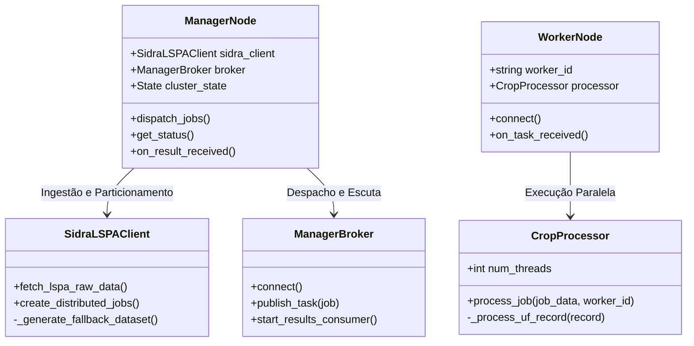
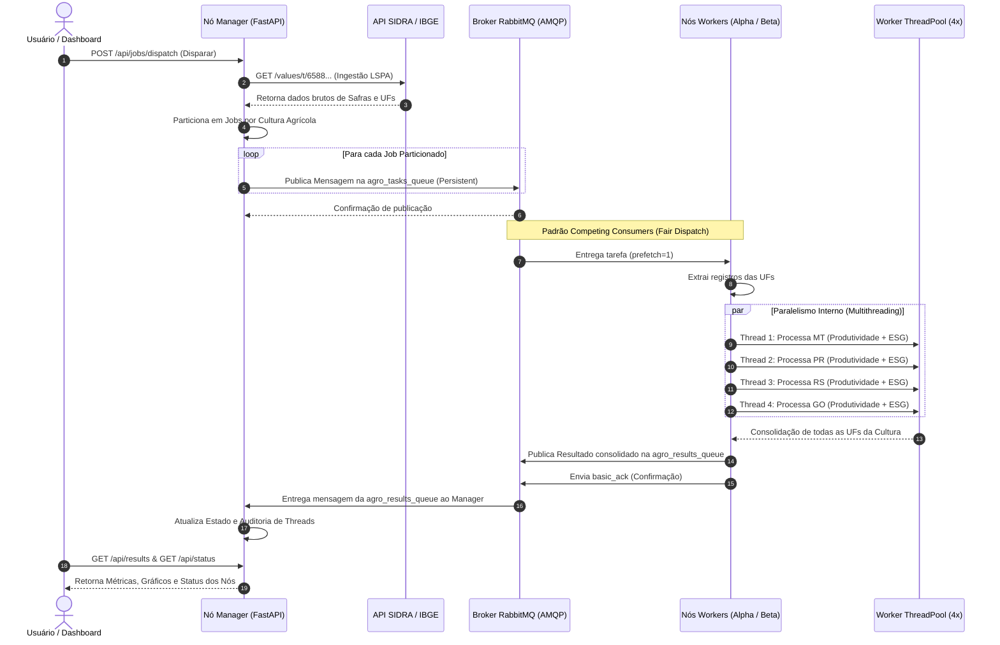

# Arquitetura de Solução: Ecossistema Distribuído para Processamento Agrícola & Métricas ESG

Este documento detalha as decisões de engenharia, a topologia distribuída adotada, os padrões arquiteturais e os diagramas UML do sistema.

---

## 1. Visão Geral e Contexto Arquitetural

O sistema tem como objetivo consumir dados analíticos da pesquisa **LSPA (Levantamento Sistemático da Produção Agrícola)** do **SIDRA / IBGE (Tabela 6588)**, particionar o volume de dados e realizar o processamento concorrente através de um cluster distribuído com topologia **Manager-Worker** orquestrado em contêineres Docker.

### Objetivos Principais:
1. **Desacoplamento e Escalabilidade**: O nó coordenador (*Manager*) não realiza processamento numérico pesado. Ele apenas ingere, particiona e orquestra as tarefas através de filas de mensageria assíncrona (*RabbitMQ*).
2. **Computação Distribuída Real**: Os nós de processamento (*Workers*) concorrem pelas tarefas distribuídas na fila AMQP de forma balanceada (*Competing Consumers Pattern*).
3. **Paralelismo Interno Efetivo**: Cada Worker emprega paralelismo interno utilizando um pool de threads (*ThreadPoolExecutor*) para processar simultaneamente múltiplos registros estaduais e calcular métricas de produtividade e índices ESG.
4. **Resiliência e Tolerância a Falhas**: Uso de confirmação de mensagens (*Message Acknowledgement - ACK/NACK*), garantindo que nenhuma tarefa seja perdida caso um Worker caia durante o processamento.

---

## 2. Diagramas UML

### 2.1 Diagrama de Topologia / Implantação de Nós (Deployment Diagram)

A topologia evidencia a separação física em contêineres dentro da rede isolada do Docker (`cluster_network`):

```mermaid
graph TD
    subgraph "Ambiente Externo"
        IBGE["API SIDRA (IBGE)<br>Tabela 6588 LSPA"]
        Client["Browser / Cliente Web<br>Dashboard Live"]
    end

    subgraph "Docker Cluster Network (bridge)"
        subgraph "Nó Coordenador (Container)"
            Manager["agro-manager-coordenador<br>(FastAPI / Python 3.11)<br>Port: 8000"]
        end

        subgraph "Message Broker (Container)"
            RabbitMQ["agro-broker-rabbitmq<br>(RabbitMQ 3 Management)<br>Port: 5672 (AMQP) / 15672 (UI)"]
            QueueTasks[("Fila: agro_tasks_queue")]
            QueueResults[("Fila: agro_results_queue")]
            RabbitMQ --- QueueTasks
            RabbitMQ --- QueueResults
        end

        subgraph "Nó de Processamento 1 (Container)"
            Worker1["agro-worker-alpha<br>(Python 3.11)"]
            Pool1["ThreadPoolExecutor<br>(4 Threads Internas)"]
            Worker1 --- Pool1
        end

        subgraph "Nó de Processamento 2 (Container)"
            Worker2["agro-worker-beta<br>(Python 3.11)"]
            Pool2["ThreadPoolExecutor<br>(4 Threads Internas)"]
            Worker2 --- Pool2
        end
    end

    IBGE -->|HTTP GET / Ingestão| Manager
    Client <-->|HTTP / Polling / REST| Manager
    Manager -->|Publica Tarefas| QueueTasks
    QueueTasks -->|Consome (Fair Dispatch)| Worker1
    QueueTasks -->|Consome (Fair Dispatch)| Worker2
    Worker1 -->|Publica Resultados| QueueResults
    Worker2 -->|Publica Resultados| QueueResults
    QueueResults -->|Consome Assincronamente| Manager
```

---

### 2.2 Diagrama de Componentes

Detalhamento das responsabilidades de cada componente interno nos módulos:



---

### 2.3 Diagrama de Sequência (Fluxo Completo de Execução)

Demonstra a ordem temporal das mensagens entre os nós:



---

## 3. Justificativa das Escolhas de Design e Tecnologias

| Componente | Tecnologia | Justificativa Arquitetural |
| :--- | :--- | :--- |
| **Linguagem Principal** | Python 3.11 | Ecossistema padrão de análise de dados, facilidade na manipulação de JSONs do IBGE e suporte nativo a multithreading (`concurrent.futures`). |
| **Framework do Manager** | FastAPI | Alta performance assíncrona (`asyncio`/ASGI), documentação Swagger nativa e facilidade para servir tanto API REST quanto UI Web. |
| **Message Broker** | RabbitMQ (AMQP 0-9-1) | Mensageria comprovada em ambiente corporativo. Garante entrega garantida (*At-Least-Once Delivery*), persistência de mensagens e *Fair Dispatch* (`prefetch_count=1`), evitando que um worker fique sobrecarregado enquanto outro fica ocioso. |
| **Paralelismo Interno** | `ThreadPoolExecutor` | Cada nó worker não é um processo monolítico simples. Ele despacha cálculos analíticos concorrentes em múltiplas threads nativas do SO, aproveitando núcleos de CPU e I/O concorrente. |
| **Orquestração** | Docker & Docker Compose | Isolamento completo de dependências, reprodutibilidade em qualquer máquina e declaração explícita dos papéis dos nós no cluster. |

---

## 4. Alinhamento Temático: Agronegócio & Sustentabilidade ESG

A pesquisa LSPA do IBGE foca nas principais culturas do agronegócio nacional (Soja, Milho, Cana-de-açúcar, Trigo, Café, Algodão e Arroz).

O sistema implementa uma métrica de **Intensificação Produtiva Sustentável (Score ESG)**:
$$\text{Produtividade} = \frac{\text{Produção (kg)}}{\text{Área Colhida (ha)}}$$

* **Classificação Excelente (ESG 90-100)**: Quando a variação da produção agrícola ($\Delta P$) supera a variação da área colhida ($\Delta A$). Isso comprova que o país está produzindo mais alimentos e biocombustíveis através de **ganho tecnológico, biotecnologia e eficiência**, e **não** através do desmatamento ou expansão desenfreada de terras.
